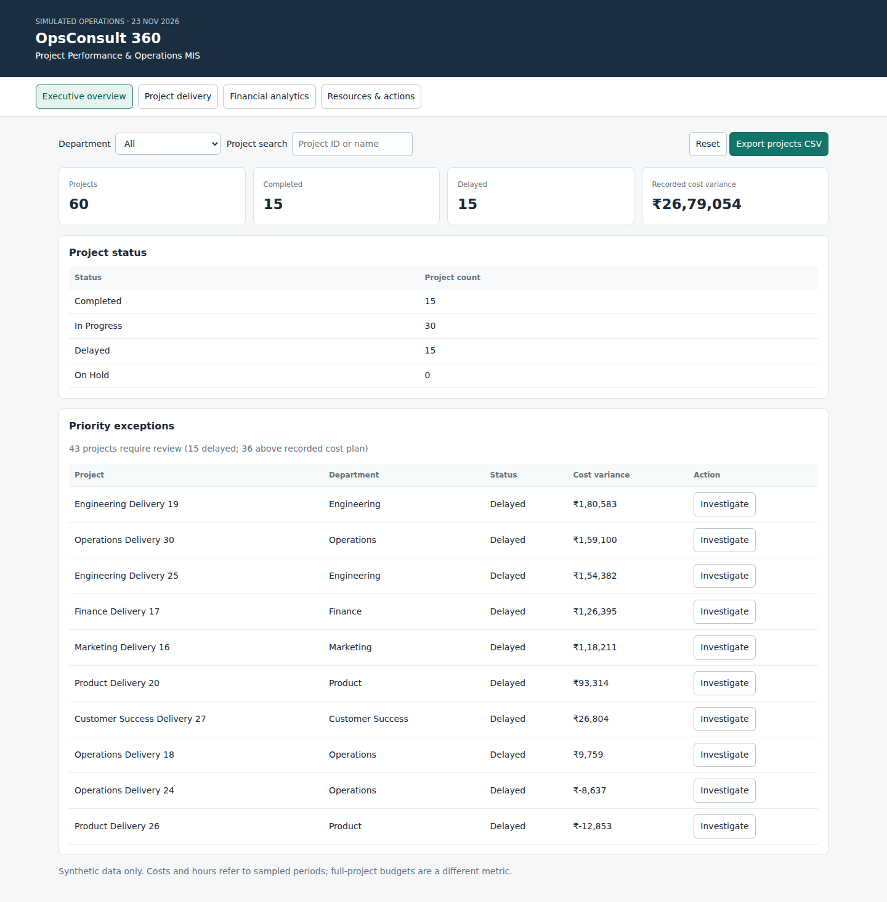

# OpsConsult 360
**Business Operations MIS · Excel · SQL · Power BI · Interactive Dashboard**

[**Portfolio case study**](https://ved-khairnar-fieldnotes.freekestrel33.chatgpt.site/projects/opsconsult-360/) · [**Live management dashboard**](https://opsconsult360.vercel.app/) · [**Project screenshots**](docs/screenshots/) · [**Interview demonstration**](docs/INTERVIEW_DEMO.md) · [**Validation summary**](docs/EXCEL_POWERBI_FINAL_ACCEPTANCE.md)

> **Portfolio simulation.** Every record is synthetic; this project is not affiliated with, deployed by, or based on confidential records from any employer.

## Executive summary

OpsConsult 360 is a management information system for tracking project delivery, recorded-period costs and variances, staffing utilization, and action ownership. It supports a reproducible workflow: **Observe → Investigate → Explain → Decide → Report.**

The sample dataset includes **60 projects, 360 tasks, 240 finance records, 48 employees, 240 timesheets and 21 actions**. The portfolio contains **15 completed and 15 delayed projects**. Recorded-period actual cost is **₹68,629,054.29** against planned cost **₹65,950,000**, an unfavorable variance of **₹2,679,054.29**. These are simulated figures, not claimed operational improvements.

## Try the dashboard

**[Open the live dashboard](https://opsconsult360.vercel.app/)**

The four-view HTML management dashboard includes department/status filtering, interactive status and variance analysis, project investigation, CSV export, and responsive mobile presentation. It is **separate from the native Power BI report**.



[Project delivery](docs/screenshots/02-project-delivery.png) · [Financial analytics](docs/screenshots/03-financial-analytics.png) · [Resources and operations](docs/screenshots/04-resources-actions.png) · [Mobile view](docs/screenshots/05-mobile-overview.png)

## Deliverables

| Area | What it contains | Source |
|---|---|---|
| Excel | 19-sheet source MIS workbook, formulas, executive review and reconciliation | [Source workbook (.xlsx)](excel/OpsConsult_360_Excel_Final_Review.xlsx) |
| Native Excel | Separately tested 22-sheet macro-enabled workbook: 3 native PivotTables, 3 Department slicers and VBA preserved | [Download final native Excel workbook (.xlsm)](excel/OpsConsult_360_Finall.xlsm) · [VBA creation module](excel/CREATE_NATIVE_PIVOTS.bas) |
| Power BI Service | Report tested in My workspace: Executive Overview, Project Performance, Financial Analytics, Resource & Operations, plus Project Detail drill-through | [Power BI acceptance notes](docs/POWER_BI_ACCEPTANCE.md) |
| SQL | SQLite database and repeatable business queries | [Database](sql/opsconsult.db) · [Analysis SQL](sql/analysis.sql) |
| Data | Six linked synthetic source tables | [CSV datasets](data/) |
| Web | Live four-view management dashboard, source HTML/CSS/JS | [Dashboard source](dashboard/) |
| Management | Five-slide COO-style summary and interview walkthrough | [Presentation](docs/COO_Management_Review.pptx) · [Walkthrough](docs/INTERVIEW_DEMO.md) |

**Power BI access:** The native report is hosted in an authenticated Power BI Service workspace. No shareable report URL or `.pbix` has been supplied to this repository; the public HTML dashboard is not the Power BI report. The previously shared Power BI URL points to the **semantic model**, not the report. Access to a private workspace may require an authorized account.

## Power BI report and verification

Four original report pages were reported as rendered and functional; **13 saved DAX measures** were reported to execute, and **10 Power BI-to-Excel KPIs** were reported to reconcile. Subsequent testing identified and then reportedly resolved formatting, project drill-through and return, and reporting-period filtering; Department/Status filtering and saved-report persistence passed. The owner confirmed the final acceptance checks passed on **23 November 2026**.

These are **owner/ChatGPT Work-reported application-test results**, not independently reproduced by this GitHub-only documentation update. Full detail and evidence limitations: [Power BI acceptance record](docs/POWER_BI_ACCEPTANCE.md). Repository includes [reference DAX](powerbi/measures.dax) and [model setup notes](powerbi/POWER_BI_SETUP.md), but no exported Power BI report file.

## Excel acceptance

The final user-provided `OpsConsult_360_Finall.xlsm` was inspected separately: valid ZIP/Office package, **22 sheets, 3 real native PivotTable XML parts, 3 slicer XML parts and preserved VBA**. Saved pivot totals were reconciled against project sources in a previous review. Excel’s interactive slicer filtering was tested by the workbook owner. **The final `.xlsm` is committed to GitHub and its Git blob hash matches the validated local upload exactly** (`642a68ba65b7f3f3127259f61a265f63bb5a12f6`). The `.xlsx` remains the original 19-sheet source and must not be presented as having native PivotTables. [Excel acceptance record](docs/EXCEL_POWERBI_FINAL_ACCEPTANCE.md).

## Data modeling and KPI integrity

- Project ID joins the project table to task, finance, timesheet and action records; employees link to timesheets.
- Aggregate financial transactions at the correct grain to avoid double counting on one-to-many joins.
- Financial costs and revenues represent recorded sample periods; do not compare them indiscriminately with full-lifecycle budgets.
- Resource utilization is sampled hours divided by sampled availability, not a claim about entire organizational capacity.
- The data and outcomes are fictional; recommendations represent possible management decisions.

More information: [KPI dictionary](docs/KPI_DICTIONARY.md) · [Automated QA](docs/AUTOMATED_QA.md).

## Run and reproduce

1. Open [the live dashboard](https://opsconsult360.vercel.app/) or download the repository and open `dashboard/index.html` locally.
2. Open the source Excel workbook; view **COO Review**, **Project Investigation**, **Pivot Analysis** and **Executive QA Plus**. For native PivotTables and slicers, open [the final macro-enabled workbook](excel/OpsConsult_360_Finall.xlsm); it is separate from the original `.xlsx` source.
3. Explore the [six CSVs](data/) and [SQLite queries](sql/analysis.sql).
4. For the authenticated native Power BI report, use the workspace owner’s Power BI Service access.

```bash
python3 tools/build_assets.py
python3 tools/qa_data.py
node tools/dashboard_smoke.cjs
```

Automated [Chromium visual QA](.github/workflows/visual-qa.yml) and [public deployment smoke testing](.github/workflows/live-site-smoke.yml) previously passed. The Vercel site was deployed from an API snapshot; GitHub commits **do not automatically redeploy** it.

## Recruiter interview

A practical two-minute walkthrough is in [docs/INTERVIEW_DEMO.md](docs/INTERVIEW_DEMO.md): explain a delayed-project KPI, investigate departmental cost variance, identify action ownership, and propose a defensible management follow-up. Clearly identify synthetic data and separate tested features from not-yet-published artifacts.
