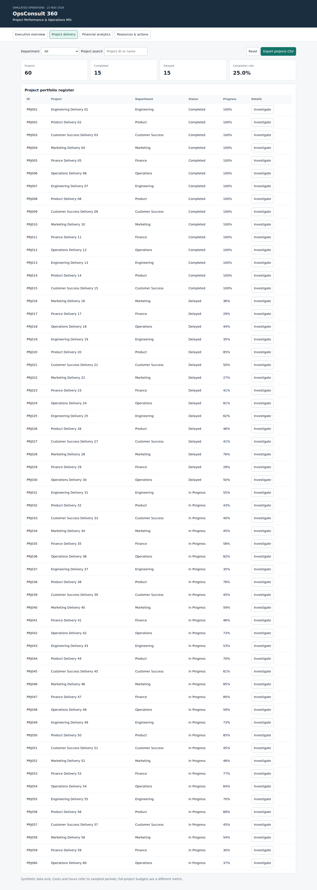
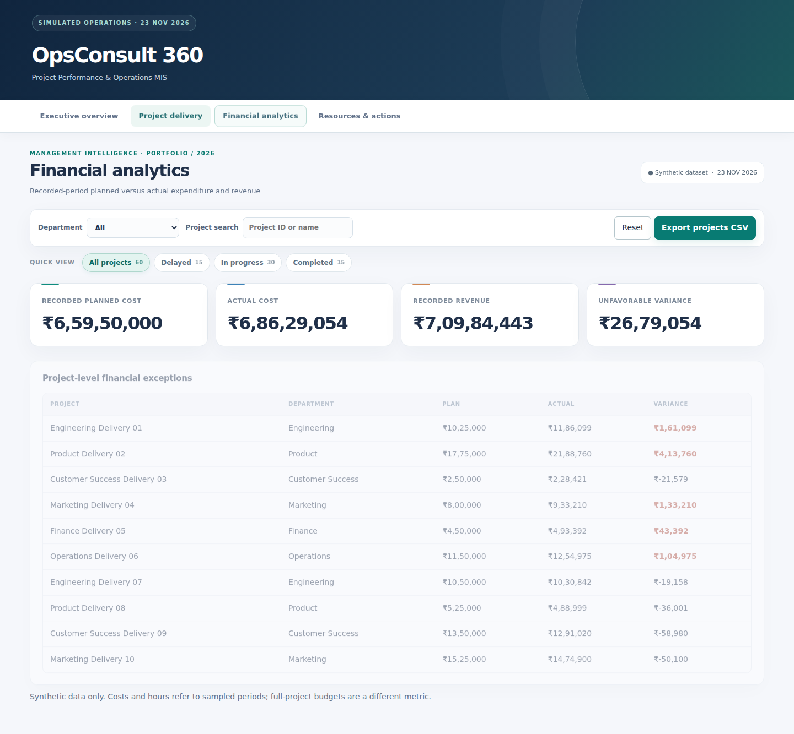
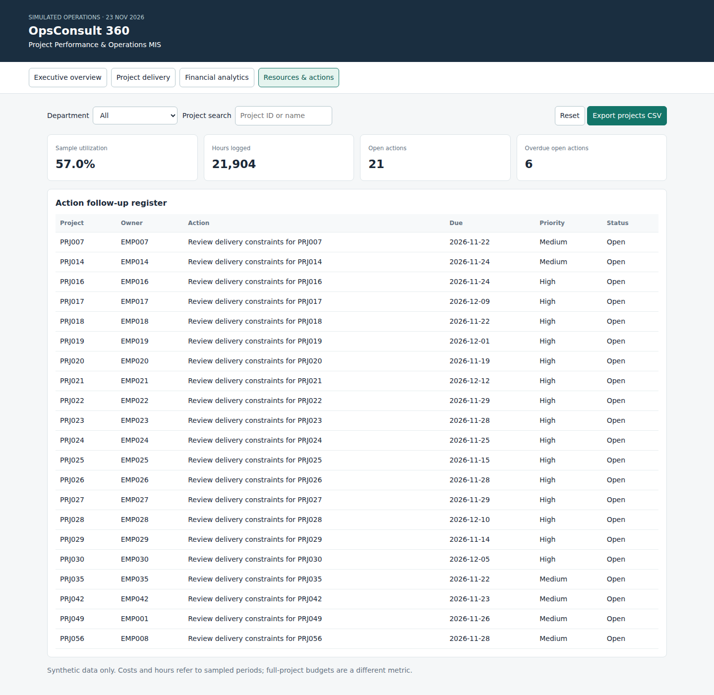

# OpsConsult 360

## v2 — Recruiter-grade enterprise UI

**Live Vercel production deployment:** [opsconsult360.vercel.app](https://opsconsult360.vercel.app/). The production deployment is marked READY, and its CSS/JS/HTML asset manifest was inspected. Independent external HTTP verification was unavailable in this chat.

The original synthetic dataset and reporting calculations are preserved. v2 improves presentation and decision-making without adding fabricated results:

- Consistent enterprise typography, dark navy masthead, teal highlights, responsive KPI cards and accessible focus states.
- One-click **All / Delayed / In progress / Completed** quick filters that update existing project KPIs and tables.
- Interactive **delivery composition** and **department cost variance** charts derived from the live filtered dataset.
- Grounded **Management attention** summary (delays, sampled-period cost overruns, open actions), not algorithmic risk forecasts.
- Project investigation details, financial checks, department filtering, reset, project search and CSV export retained.
- Reduced-motion support and responsive layout at mobile widths.

**QA:** The GitHub [v2 browser suite](.github/workflows/visual-qa.yml) passed with real Chromium testing of navigation, KPI filters, chart rendering, CSV downloads, project investigation, reset, and a 390px responsive viewport. Updated screenshots are in [docs/screenshots](docs/screenshots).

**Limitations:** This is the standalone HTML dashboard, not the native Power BI report. Native Excel PivotTables and slicers, and account-level Power BI final inspection remain separate tasks. The Vercel production snapshot was uploaded via API rather than a connected Git repository, so future GitHub code updates require a new deployment.

## Live interactive dashboard

**[Open OpsConsult 360 — Production dashboard](https://opsconsult360.vercel.app/)**

The Vercel production deployment is marked **READY**, the domain is verified, and deployment authentication/password protection is disabled. The repository's Playwright tests passed for the matching GitHub dashboard source. **An independent external HTTP/browser check of the Vercel URL was not possible from this chat**; please open the link to confirm it loads in your browser.

The website is the self-contained HTML dashboard; Power BI is a separate reporting component and is **not embedded** here. The deployment was created from a snapshot of `dashboard/index.html` rather than a linked Vercel Git repository; future GitHub commits will not automatically update this deployment.

**Project Performance & Operations MIS** · Advanced Excel · SQL · Management Reporting · Power BI preparation

A professional portfolio case study for business operations and COO reporting. **All records are synthetic** and do not describe Celoxis or any real employer.

## Purpose
Support the full operations workflow: **Observe → Investigate → Understand → Decide → Report.** Review project delivery, cost overruns, recorded revenue, staffing capacity and follow-up ownership.

## Repository structure

| Location | Deliverable |
|---|---|
| [excel/OpsConsult_360_Excel_Final_Review.xlsx](excel/OpsConsult_360_Excel_Final_Review.xlsx) | 19-sheet formula-driven MIS workbook and executive review |
| [excel/CREATE_NATIVE_PIVOTS.bas](excel/CREATE_NATIVE_PIVOTS.bas) | VBA module to create three *native* Excel PivotTables |
| [dashboard/index.html](dashboard/index.html) | Self-contained interactive HTML dashboard (download and open locally) |
| [dashboard/data.json](dashboard/data.json) | Synthetic data behind the offline dashboard |
| [data/](data/) | Six relational CSV datasets |
| [sql/opsconsult.db](sql/opsconsult.db) | SQLite database / reproducible data snapshot |
| [sql/analysis.sql](sql/analysis.sql) | Department, cost, monthly revenue and utilization analyses |
| [docs/COO_Management_Review.pptx](docs/COO_Management_Review.pptx) | Five-slide executive management review |
| [docs/KPI_DICTIONARY.md](docs/KPI_DICTIONARY.md) | Metric definitions, time grain and caveats |
| [docs/AUTOMATED_QA.md](docs/AUTOMATED_QA.md) | Results of automated cross-file validation |
| [powerbi/](powerbi/) | DAX measure references and authoring steps, **not a finished Power BI report** |
| [tools/](tools/) | Rebuild and verification scripts |

## Quick start
1. Download the repository ZIP from GitHub.
2. Open `excel/OpsConsult_360_Excel_Final_Review.xlsx` using Excel. Start with **COO Review**, **Project Investigation**, **Pivot Analysis**, and **Executive QA Plus**.
3. Open `dashboard/index.html` in a browser. The generated version contains embedded synthetic data and works offline. Test department filters, exception investigation, search, Reset and CSV export.
4. If SQLite is installed, run `sqlite3 sql/opsconsult.db < sql/analysis.sql`.
5. Open `docs/COO_Management_Review.pptx` to review management findings and recommended decisions.

## Advanced Excel: native PivotTables
The workbook currently has formula-based pivot-*style* summaries, **not native PivotTable objects or slicers**. To add native PivotTables in Excel on Mac:
1. Make a copy of the workbook. In Excel, enable the **Developer** tab if needed.
2. Open the Visual Basic Editor, insert/import the module from `excel/CREATE_NATIVE_PIVOTS.bas`.
3. Run `CreateOpsConsultPivotTables` and inspect the generated **Native Pivot - Delivery**, **Native Pivot - Finance**, and **Native Pivot - Resources** sheets.
4. Reconcile totals to **COO Review** and **Excel QA**. Save as `.xlsm` to preserve the macro, or copy the completed PivotTable sheets into a macro-free `.xlsx` if desired.

**The macro has been prepared, but has not been executed or tested inside Microsoft Excel.** Excel for Mac features and macro settings may vary.

## Reproducible build and QA
All six CSVs and the **GitHub version** of the offline HTML dashboard are deterministically regenerated from the committed SQLite snapshot:

```bash
python3 tools/build_assets.py
python3 tools/qa_data.py
node tools/dashboard_smoke.cjs
```

The GitHub Actions workflow performs those checks automatically, then commits any regenerated datasets/dashboard and the QA report. The GitHub HTML version **is not byte-identical to the earlier locally tested design**, although it uses the same dataset and its key logic was smoke-tested.

## Data notes
- 60 projects, 360 tasks, 240 finance rows, 48 employees, 240 timesheets and 21 actions.
- 15 completed projects and 15 delayed projects.
- Recorded-period unfavorable cost variance: **₹2,679,054.29**.
- Sampled finance, projects and timesheets have different reporting grains. Do not equate sampled financial cost with a whole-project budget or sampled utilization with total organization capacity.
- These figures demonstrate a simulated scenario, not measured business impact.


## Verified interface screenshots

The dashboard has been captured in a real headless Chromium browser, with department filtering and Reset checked during the same automated run. These are screenshots of the **GitHub-regenerated HTML dashboard**, not the older local HTML version.

| Executive overview | Project delivery |
|---|---|
|  |  |

| Financial analytics | Resource and operations |
|---|---|
|  |  |

- [Interview walkthrough](docs/INTERVIEW_DEMO.md)
- [Power BI acceptance checklist](docs/POWER_BI_ACCEPTANCE.md)
- [Cross-source automated QA results](docs/AUTOMATED_QA.md)
- [Visual QA workflow](.github/workflows/visual-qa.yml)

The screenshots, view navigation, department filtering, and Reset were verified using Playwright in GitHub Actions. Native PivotTable creation in Excel for Mac and the saved Power BI Service report still need application-level inspection.

## Completion and limitations
**Verified:** repository file presence, six-table reconciliation with SQLite, key project and finance KPIs, workbook package structure, no cached formula errors, dashboard JavaScript smoke tests, 5-slide presentation structure.

**Pending:** live Excel macro/PivotTable execution, full Excel recalculation and slicer testing, manual browser-level acceptance of the GitHub-regenerated dashboard, and Power BI Service report validation. A native `.pbix` is not included.

## Portfolio interview demonstration
Start with a delayed-project KPI, filter to the department, inspect a project and its recorded cost variance, review owner follow-ups, and present one defensible corrective action. Clearly distinguish observations from recommendations.
